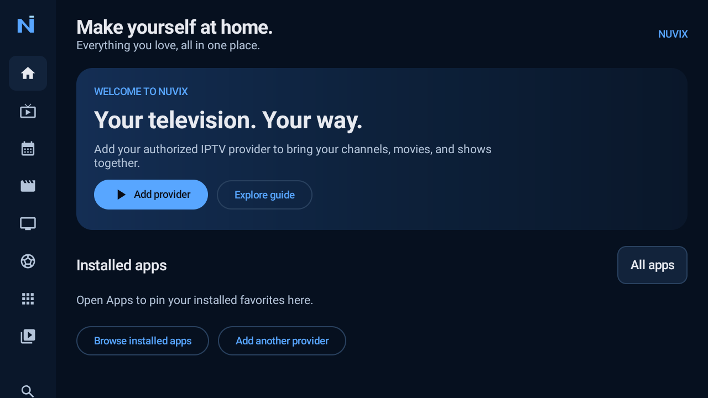

# Nuvix

**Your television. Your way.**

Nuvix is a free, open-source IPTV player and optional home launcher for Android TV, Google TV, and compatible Fire TV devices. Bring your own authorized provider—no channels, accounts, playlists, or media are included.

An independent modified version of [OpenTV](https://github.com/opentvproject/opentv),  Nuvix is not affiliated with OpenTV or DIRECTV and uses no DIRECTV assets.

## Features

- Live TV, time-grid guide, movies, TV shows, and remote-friendly navigation.
- [Mini TV Guide](docs/mini-tv-guide.md): press Left during immersive live TV, browse without tuning, OK to watch, Back to close; local transparency, position and idle-timeout settings.
- M3U/M3U8, Xtream Codes, authorized Stalker/MAC portals, and XMLTV.
- Favorites, continue watching, search, multiple providers, and LAN/NAS sync.
- Adjustable buffering, catch-up where supported, PiP, recordings, and reminders.
- Optional home launcher with installed-app shortcuts and customizable startup destinations.
- Automatic TVmaze show, season, episode, and cast metadata with clickable actor profiles; no key required. See [TV metadata](docs/tv-metadata.md).
- Optional Supabase sync for content favorites and movie/episode progress.
- Encrypted local provider/catalog storage and protected credentials.
- In-app release checks, downloads, and Android-approved updates.

Recording, playback, and launcher support depend on your device and provider. Cloud sync is disabled by default and excludes provider credentials and stream URLs; settings and launcher preferences remain local.

## Screenshot

Nuvix Home on an Android TV emulator, with no provider configured.



## Build and install

Development APKs use `com.disabledabel.nuvix.debug`. Production releases require configured signing and use `com.disabledabel.nuvix`; debug and release installations have separate data.

Use Android Studio with JDK 17 and Android SDK 35, or build with:

```sh
./gradlew :app:testDebugUnitTest :app:lintDebug :app:assembleDebug
```

Install with:

```sh
adb install -r app/build/outputs/apk/debug/app-debug.apk
```

See [build instructions](docs/building.md), [signing](docs/signing.md), and [release publication](docs/RELEASING.md).

## Setup

- **Providers:** Open **Settings → Providers** or **Add provider** on Home. Add your authorized playlist, Xtream account, or assigned Stalker portal/MAC, then configure XMLTV if needed. Prefer HTTPS.
- **Launcher:** Open **Settings → Home launcher** and enable the HOME entry. Use your device's default-home selector where supported. Restore the original default launcher before disabling the entry. See [device compatibility](docs/launcher-compatibility.md).
- **Cloud sync:** Configure your project and sign in under **Settings → Supabase cloud sync**, then enable sync. Use only a publishable/anon client key. See [cloud setup](docs/cloud-sync.md) and [privacy](docs/PRIVACY.md).
- **Updates:** Open **Settings → Nuvix updates**. Stable updates require valid release metadata and a matching signing certificate; Android requires installation approval. See [update troubleshooting](docs/update-troubleshooting.md).

## Project status

Nuvix is in development. Real-device testing is still needed for launcher selection, remote navigation, playback, database migration, cloud sync, and APK updates.

See the [implementation report](docs/implementation-report.md), [roadmap](docs/ROADMAP.md), [architecture](docs/nuvix-architecture.md), and [contributing guide](CONTRIBUTING.md).

## License

**GPL-3.0.** Copyright (C) 2026 The OpenTV Contributors; Nuvix modifications Copyright (C) 2026 Nuvix Contributors.

Original license and source notices are preserved. See [LICENSE](LICENSE), [COPYING.md](COPYING.md), [third-party notices](THIRD_PARTY_NOTICES.md), and the [upstream audit](docs/upstream-audit.md). Release APKs include the corresponding tagged source, build scripts, and migrations.
